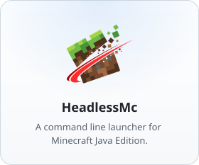
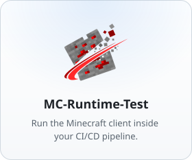
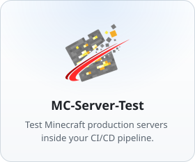
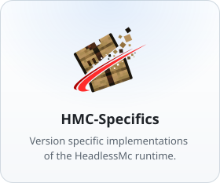
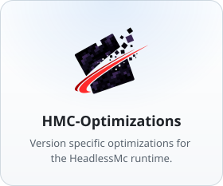

<h1 align="center">HeadlessHQ</h1>

Tools for launching, running and testing Minecraft Java Edition clients/servers.

<!-- tiles:start -->

  <a href="https://github.com/headlesshq/headlessmc"><picture><source media="(prefers-color-scheme: dark)" srcset="assets/tiles/headlessmc-dark.svg"></picture></a>
  <a href="https://github.com/headlesshq/mc-runtime-test"><picture><source media="(prefers-color-scheme: dark)" srcset="assets/tiles/mc-runtime-test-dark.svg"></picture></a>
  <a href="https://github.com/headlesshq/mc-server-test"><picture><source media="(prefers-color-scheme: dark)" srcset="assets/tiles/mc-server-test-dark.svg"></picture></a>

  <a href="https://github.com/headlesshq/hmc-specifics"><picture><source media="(prefers-color-scheme: dark)" srcset="assets/tiles/hmc-specifics-dark.svg"></picture></a>
  <a href="https://github.com/headlesshq/hmc-optimizations"><picture><source media="(prefers-color-scheme: dark)" srcset="assets/tiles/hmc-optimizations-dark.svg"></picture></a>
  <a href="https://github.com/headlesshq/headlessmc-web"><picture><source media="(prefers-color-scheme: dark)" srcset="assets/tiles/hmc-web-dark.svg"></picture></a>

<!-- tiles:end -->
