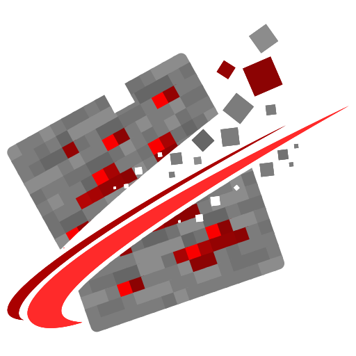

<h1 align="center">HeadlessHQ</h1>

Tools for launching, running and testing Minecraft Java Edition without a screen.

<table align="center">
  <tr>
    <td align="center" width="220">
      <a href="https://github.com/headlesshq/headlessmc">
         
        <b>HeadlessMc</b>
      </a> 
      A command line launcher for Minecraft Java Edition.
    </td>
    <td align="center" width="220">
      <a href="https://github.com/headlesshq/mc-runtime-test">
         
        <b>MC-Runtime-Test</b>
      </a> 
      Run the Minecraft client inside your CI/CD pipeline.
    </td>
    <td align="center" width="220">
      <a href="https://github.com/headlesshq/mc-server-test">
         
        <b>MC-Server-Test</b>
      </a> 
      Test Minecraft production servers inside your CI/CD pipeline.
    </td>
  </tr>
  <tr>
    <td align="center" width="220">
      <a href="https://github.com/headlesshq/hmc-specifics">
         
        <b>HMC-Specifics</b>
      </a> 
      Version specific implementations of the HeadlessMc runtime.
    </td>
    <td align="center" width="220">
      <a href="https://github.com/headlesshq/hmc-optimizations">
         
        <b>HMC-Optimizations</b>
      </a> 
      Version specific optimizations for the HeadlessMc runtime.
    </td>
  </tr>
</table>
